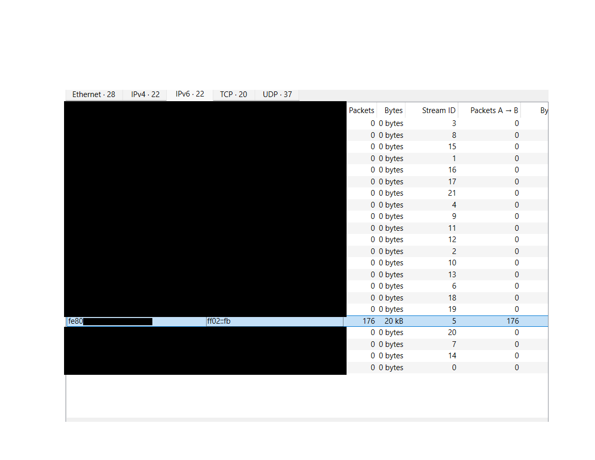

# Wireshark Network Traffic Analysis

My goal when starting this project was to strengthen my Wireshark skills and explore the network analysis 
side of cybersecurity, an area I previously lacked confidence in. Understanding network traffic is essential 
in cybersecurity because the details matter. Learning how and why data moves across networks, while developing
the ability to recognize unfamiliar or unusual activity, is an important part of identifying potential 
security threats.

## Tools and Technologies

- **Wireshark** – Network packet capture and traffic analysis.
- **VirusTotal** – IP address reputation and threat intelligence investigation.

## Methodology 

I began the investigation by opening Wireshark and selecting the Wi-Fi network interface to capture network 
traffic. After allowing the capture to run, I stopped it and examined the recorded packets, including their 
protocols, source addresses, and destination addresses.

Next, I navigated to **Statistics → Conversations** and selected the IPv6 tab to examine communication between 
network addresses. During this process, I identified a conversation containing 176 packets and approximately 
20 KB of transmitted data. The traffic appeared to travel in only one direction, with no packets returning from 
the destination address.

Although this activity was not necessarily suspicious, I decided to investigate further to understand why the 
packets were being transmitted and determine whether the behavior was consistent with normal network 
communication.

## Findings and Analysis

During my investigation, I identified an IPv6 link-local source address beginning with `fe80` and a multicast 
destination address beginning with `ff02`. Initially, the one-way communication appeared unusual because I
observed packets being transmitted without direct responses.

After researching the purpose of these IPv6 addresses, I learned that link-local addresses support communication
within a local network, while multicast addresses allow packets to be sent to a group of devices. This helped
me understand why communication could appear one-sided without necessarily indicating suspicious activity.

Further analysis revealed that the traffic involved mDNS queries related to AirPlay service discovery. This
provided a reasonable explanation for the multicast communication I observed.

After identifying `_airplay._tcp.local` within the mDNS packets, I connected this evidence to the one-way
traffic I had previously observed. I determined that the device was using mDNS to discover available AirPlay
services on the local network. This helped explain why packets were being sent to a multicast address without
necessarily receiving direct responses. Based on these findings, I concluded that the traffic was consistent 
with normal network discovery activity rather than evidence of malicious behavior.

During further investigation, I identified additional mDNS packets containing responses and AirPlay service 
information. An earlier query referenced a service named Living Room, while a response I examined advertised 
an AirPlay service named Girls room.

I also noticed that the original conversation used IPv6 addresses, while the response I investigated used IPv4. 
The response originated from a private IPv4 address beginning with `10.` and was sent to the multicast address
`224.0.0.251`.

This helped me understand that mDNS can operate over both IPv4 and IPv6 and that devices can advertise available 
services through multicast communication. Although both packets were related to AirPlay, I could not confirm 
that the Girls room response directly answered the earlier Living Room query.

### IPv6 Conversation Analysis 

## Conclusion

After completing my investigation, I concluded that the traffic I examined was consistent with normal network 
communication involving IPv6 link-local addresses and multicast addresses. Through this project, I developed 
a better understanding of how to interpret captured packets in Wireshark, analyze network communication, and 
recognize activity that may require further investigation.

One of the most valuable lessons I learned is that network traffic is not always what it initially 
appears to be. Activity that seems unusual may have a legitimate explanation, while traffic that appears normal
may still require closer examination. This experience taught me the importance of investigating the evidence
 , understanding network protocols, and avoiding assumptions when assessing potential security threats.

Although I identified AirPlay-related service discovery traffic, I could not confirm the exact device that
originated the communication or whether an AirPlay streaming connection was successfully established.
